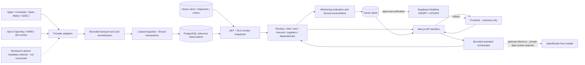

# ALTAIR Backend Guide

Internal engineering handoff · audited 2026-11-07 · Task 008A, documentation only.

This describes the **current working tree**, not just committed `main` or the intended product. No application, schema, API or frontend implementation was changed for this handoff. Read [System Status](ALTAIR_SYSTEM_STATUS.md) for fresh verification and activation blockers; [API Reference](ALTAIR_API_REFERENCE.md) for wire contracts; [Frontend Handoff](ALTAIR_FRONTEND_HANDOFF.md) for integration order.

## 1. What exists

ALTAIR is a Next.js 15 Node backend with deterministic logistics/supply engines, Supabase cookie authentication, PostgreSQL ownership policies, bounded provider ingestion, private snapshot simulations, monitoring/alerts, and optional tool-driven OpenRouter assistance. There are **28 route files / 31 explicit HTTP operations**, including two internal scheduler endpoints. There are **25 application tables**, nine migrations, and no separate deployed worker service.

**Working** below means implemented with passing local tests, not production activation. **Partially Working** means a real subsystem exists but a required end-user integration is missing. **Requires Configuration** means code exists but access/data/runtime activation is not established. **Not Implemented** means no corresponding application interface or behavior was found. Live access is never inferred from a fixture pass.

Only `/` is a frontend page in this checkout, rendering `ALTAIR`. The named operational screens, sign-in UI, browser Auth client and auth callback/middleware are absent. Existing backend session verification is not a complete frontend authentication flow.

## 2. Architecture and boundaries

| Code boundary | Responsibility / actual entry points |
|---|---|
| `packages/shared/src/contracts/` | Browser-safe Zod inputs/outputs and TypeScript types, re-exported by `@altair/shared/contracts`. API payloads use camelCase. |
| `packages/db/src/schema/{reference,private,ingestion}.ts` | Drizzle table models; SQL migrations additionally own policies, grants, triggers and RPCs. |
| `packages/db/src/ingestion-store.ts` | Trusted observation persistence, leases/cache/cooldown/history, atomic upserts. |
| `packages/backend/src/providers/`, `transport.ts`, `decimal.ts` | Fixed-source adapters, bounded HTTP/WSS, exact trade numeric normalization. No default synthetic fallback. |
| `packages/backend/src/read.ts`, `routing/`, `intelligence/`, `supply/` | Validated observation retrieval and deterministic engines/HTTP service factories. |
| `packages/backend/src/monitoring/` | Current-operation evaluations, row normalization, per-owner scheduler. |
| `packages/backend/src/assistant/` | Allowlisted tools, input approval, provider transport, evidence selection, guarded orchestration. |
| `apps/web/lib/backend/` | Server-only Supabase stores, owner filters, RPC dispatch, provider gates. |
| `apps/web/lib/supabase/{server,auth}.ts` | Cookie server client; `getAuthenticatedUser()` calls `auth.getUser()` to verify identity. |
| `apps/web/app/api/` | Thin Next.js Node route wrappers. No frontend import of backend/db is permitted. |
| `packages/db/operations/` | Inactive, operator-run Cron and alert Realtime templates, **not migrations**. |

Normal user services use the verified user's Supabase client/JWT and database RLS, not an admin client. The direct PostgreSQL connection is used for health, trusted ingestion and scheduler admission. Scheduled private evaluations explicitly switch to `authenticated` with the database-selected owner's subject. No user-selected owner/provider URL enters those schedulers.

## 3. Actual workflow sequences

### Shipping alternatives

1. The UI supplies existing catalog origin/destination UUIDs, shipment constraints, priorities and explicit hypothetical consent to `POST /api/v1/routes/compare`.
2. `routeCompareHandler` verifies the cookie identity, calls `intelligence_snapshot()` once, and normalizes the network and targeted evidence.
3. `compareRoutes()` removes incompatible directed edges, searches bounded simple paths, aggregates known costs/durations/risks and ranks the evaluated candidates.
4. Optional geometry enrichment uses up to two already-returned edges only if both server and request gates permit it. It cannot create a logistics service or replace freight price/transit evidence.
5. The result exposes alternatives, geometry gaps, conditional/rejected reasons, confidence, provenance and search coverage. An empty network/path is not a successful freight booking.

**Dependencies:** curated `locations`/`transport_connections`, sufficient source metadata and an authenticated session. No REST location picker/network listing or shipment-create endpoint exists. A route request is an ephemeral requirement, not a persisted shipment.

### Detected geopolitical/logistics disruption

1. An authorized ingestion job stores article metadata, weather/marine estimates or opt-in road observations. Trusted operators may maintain structured `risk_signals`.
2. On intelligence reads, `normalizeRisks()` combines validated targeted signals with threshold-derived weather evidence. Unmapped news is counted, not guessed onto a location. There is no automatic news-to-closure pipeline.
3. `GET /api/v1/risks` filters category/target/applicability and returns evidence and coverage. Route comparison uses the same active targeted exposure.
4. Monitoring considers high/critical targeted signals and explicitly mapped current road evidence for private alerts. A temporary road-closure overlay can affect monitoring forecasts; stored connections remain unchanged.

**No** news-derived confirmed closure, automatic rerouting, carrier notification, or write to shared risk from private owner records is implemented.

### Crisis simulation

1. `POST /api/v1/scenarios` validates the input and calls invoker `create_simulation`.
2. The insert trigger captures one statement-consistent owner-visible network/evidence/stock/shipment snapshot, fixes time/version/reference, validates targets and prevents later baseline/input replacement.
3. Creation performs domain validation of the captured record and returns a record with `output:null`. Create is not an idempotency-key API; avoid blind retries after an uncertain response.
4. `POST /api/v1/scenarios/{id}/execute` takes **no body**, computes baseline and changed conditions from a deep copy, then persists one output through row-locked `finish_simulation`.
5. `GET /api/v1/scenarios/{id}/compare` recomputes and checks the stored output before returning it. Re-execution is deterministic for the stored supported engine/version. No provider calls or live operational rereads are used for replay.

Creation/storage and the post-insert JavaScript validation are not one database transaction. SQL rejects known invalid targets atomically; a later normalization/resource/domain failure is not a documented rollback guarantee. The detail GET validates stored shapes but does **not** perform the execution/compare integrity recomputation; use `/compare` for a verified stored calculation.

### Predicted inventory shortage

1. Owner stock exists in an owned warehouse; immutable movement inserts maintain its balance. Explicit `historyStart` declares the complete consumption-history window. Orders/reservations are separate declarations.
2. `POST /api/v1/forecasts` takes an inventory UUID and selected assumptions. `supply_inventory_snapshot` reads stock, recent movements, active orders, linked nonterminal shipments and a consistent baseline.
3. `forecastInventory()` computes demand statistics, available stock, dated commitment/receipt projection, shortages and lead/coverage purchase requirements.
4. Incoming quantities count only with current private verification. Route-linked arrivals reuse `evaluateReplenishment()`; unknown arrivals/routes/verification are excluded with limitations, not upgraded to zero-risk assumptions.
5. With `scenarioId`, the owned stored baseline must match current normalized operations/evidence; otherwise 409 `scenario_baseline_changed`. Modifications apply in memory, never to stock. History/orders/time are current overlays, not a persisted forecast replay.

Forecasts are read-only results; they do not place purchase orders or receive goods. Missing recurring demand still permits a clearly labeled commitments-only lower bound.

### Supplier alternatives

1. `POST /api/v1/suppliers/search` validates product and/or HS edition/prefix, country/location and capability filters.
2. `supply_supplier_snapshot()` retrieves trusted supplier/product/capability/evidence rows. Supplier country comes from its linked location, not organization inference.
3. `matchSuppliers()` applies all requested criteria, excludes rejected suppliers and grades evidence freshness/verification.
4. The response returns UUID-ordered matches, evidence links, reasons and an explanatory score. Even `confirmed_catalog_match` has **`availability:"unverified"`**.

There is no live supplier search provider, stock quotation, automatic substitution, procurement execution or scenario exclusion filter in this search contract. The frontend must visibly distinguish the unavailable supplier in a hypothetical scenario from possible catalog alternatives.

### Live logistics observation

1. An enabled approved OpenSky/HERE polling job, or one bounded AIS worker invocation, collects external network metadata.
2. The adapter validates positions/event times/units, attaches source/license/nature and per-event `freshUntil`, and uses stable event keys.
3. Shared ingestion upserts the normalized batch transactionally. A failure retains last good observations and reports a failure/cooldown separately.
4. `GET /api/v1/observations` returns aircraft/vessel/traffic records using UUID pagination. The UI must select latest events per appropriate provider/job/providerId and check both event and sync expiry.

There is no public observation-ingest endpoint, shipment tracking webhook, continuous browser stream, cargo-to-broadcast association, or webcam read route. Broadcast positions are **not shipment positions**.

### Automated alert

1. The user replaces their config through `PUT /api/v1/monitoring/config`, choosing explicit shipment-edge, road-ID-edge and stock/forecast mappings. GET defaults alone do not persist a scheduled configuration.
2. A user `POST /api/v1/monitoring/evaluate` with `{}` or an approved internal scheduler invocation captures current RLS-visible inputs and evaluates six deterministic rules.
3. `reconcile_monitoring` locks the owner settings and rejects changed revision, expired/future or superseded evaluation time before atomically applying alert episodes.
4. `GET /api/v1/alerts` retrieves private alerts. Optional approved Realtime INSERT/UPDATE events trigger refetch; they are not the authoritative payload or external delivery guarantee.
5. PATCH acknowledges or resolves. Repeat active evaluation does not notify again; escalation or recurrence can reopen and increment counters. Missing evidence does not silently clear evidence-based alerts.

### AI logistics question

1. `POST /api/v1/assistant/chat` verifies the user and reserves a private turn via database-serialized admission/quota checks before inference, even if inference is disabled.
2. The orchestrator sends fixed policy, at most four prior **user** messages, the current request and tool definitions to the configured free-only OpenRouter adapter.
3. Tool names/arguments/permissions and current-request assumption approvals are checked server-side. Tools call the same user-authorized domain services; only explicitly permitted scenario creation/execution writes private calculations.
4. Successful tool outputs are revalidated and become bounded current-request evidence. The model selects exact allowed scalar fields and safe action templates; the server renders the findings, not arbitrary factual model prose.
5. The response and completion are persisted once. HTTP 200 may be `degraded`, with errors, retained evidence or pending approvals instead of recommendations. Deterministic endpoints do not require an LLM.

## 4. Feature inventory

All listed business APIs require verified cookie Auth; health is public and internal jobs use scheduler authentication. Sources are actual store inputs, not claims that production catalogs are populated. Request/response fields and schema exports are expanded in the API reference.

| Feature / purpose | Status and evidence | Service → API | Input → output | Data / nature | Limitations / frontend work |
|---|---|---|---|---|---|
| Source evidence browsing | Working locally; ingestion/read tests | `read.ts` → GET trade, weather, observations | job/limit/cursor → observations + availability/cursor | External normalized historical/estimated/live evidence | UUID order, not latest-time; display attribution/expiry and partial source coverage. |
| Synchronization visibility | Working locally | `readResource` → GET freshness, ingestion/status | no query → per-job freshness or sanitized runs | Stored ingestion state + latest event age | Not provider uptime or reporting-period freshness; make failures/stale/never explicit. |
| Standalone ingestion CLI | Partially Working: adapters/store pass, CLI startup fails in audited Node/tsx | `src/cli.ts` → package ingest command, no user endpoint | job name → intended IngestionResult | Same provider jobs/store as internal HTTP | Named shared-contract re-export/module-format failure occurs before execution; do not rely on CLI/worker startup until separately fixed. |
| Route comparison / cost intelligence | Working locally; routing tests | `compareRoutes` → POST routes/compare | routeRequest → routeComparison | Curated directed edges; nature per provenance | No live freight quotations/FX/implicit connections; UI collects IDs, priorities and conditions. |
| Optional navigational geometry | Requires Configuration; fixture-tested | `createRoutingAdapters` via routes/compare | enrichGeometry + server gates → providerEstimates | HERE/Searoutes estimated navigation | No live/paid verification; draw only returned geometry, preserve gaps. |
| Targeted risk intelligence | Working locally; partial coverage | `normalizeRisks`, `riskExposure` → GET risks | category/target/freshness/page → signals/coverage | Structured evidence and estimated weather; news potential | No automatic geopolitical targeting or closure; UI shows evidence, not certainty. |
| Private digital twin | Working locally; HTTP + DB tests | `simulateScenario` → scenarios create/list/detail/execute/compare | scenarioInput / owned ID → record or simulationOutput | Immutable owned snapshot + explicit simulated assumptions | No operational writes/prediction; UI create → execute (no body) → compare. |
| Stock ledger / reservation management | Working locally; trigger/RLS tests | supply handlers → inventory GET/POST/PATCH; movements POST | owned warehouse/product/stock quantities → stock/movement record | Owner-maintained operational declarations | No warehouse/product APIs, no movement listing endpoint; physical changes use movements. |
| Dated commitments | Working locally | supply handler → orders POST/PATCH | full order fields → orderRecord | Private planned/confirmed commitments | PATCH is full replacement, not arbitrary partial patch; status never moves physical stock. |
| Replenishment declaration | Partially Working end-to-end | supply handler → PATCH inventory/replenishments/{shipmentId} | destination inventory, quantity/unit, verification, route → replenishmentRecord | Existing private shipment + owner availability assertion | No create/list shipment REST API; destination/product/endpoints must match. |
| Stock forecasting / purchase review | Working locally; forecast/HTTP/DB tests | `forecastInventory` → POST forecasts | owned inventory + demand/lead/coverage/scenario → forecastResponse | Historical ledger + estimated/simulated projection | No demand/lead guess; frontend displays lower bounds, nulls and assumptions. |
| Supplier discovery | Working locally on curated fixtures | `matchSuppliers` → POST suppliers/search | catalog criteria/page → supplierSearchResponse | Trusted verification/evidence; potential/confirmed catalog | No connected external supplier directory; availability always unverified; contact action only. |
| Import dependency | Working locally; external data coverage limited | `importDependency` → POST import-dependencies | exact reporter/HS/edition/currency/provider → period concentration/exposure | Ingested historical trade, explicit country mappings | No national-completeness/physical-stock inference; separate currencies/frequencies. |
| Aircraft/vessel/road evidence | Requires Configuration; fixture/DB tests | transport jobs → GET observations | job/page → evidence-only positions/road state | Live/estimated network observations | Default disabled; no cargo tracking; UI labels observed time and stale points. |
| Private monitoring / in-app alerts | Working locally; activation gated | `evaluateMonitoring`, `runMonitoring` → config/evaluate/alerts APIs | explicit mappings/thresholds → candidates/persistence/episodes | Current operations + current applicable external evidence | No email/SMS/push; review latched alerts and threshold assumptions. |
| Alert Realtime | Requires Configuration | operator SQL template + Supabase client | JWT INSERT/UPDATE subscription → authorized refetch | Private alert changes | Not activated/connected in this checkout; polling/refetch remains available. |
| AI decision support | Requires Configuration; mock-model integration passes | `chat`, `OpenRouterProvider` → POST assistant/chat | message + optional approvals → structured evidence/findings/errors | Deterministic tool evidence, optional model selection | Missing key; no live LLM verification, history REST/SSE or booking. UI needs approval/evidence cards. |
| Shipment booking, order placement, vendor tracking, aggregate dashboard | Not Implemented | No application endpoints | None | None | Do not wire buttons to invented routes or treat schemas/tables as REST endpoints. |

## 5. Database model and ownership

### Table inventory (all 25)

| Boundary | Tables | Important relationships / contents |
|---|---|---|
| Shared reference, authenticated-read/trusted-write | `organizations`, `locations`, `transport_connections`, `products`, `suppliers`, `disruptions`, `risk_signals`, `data_sources` | Suppliers → organization/location; edges → explicit origin/destination; disruptions → location/source; risks → location/disruption/source and optional edge/supplier. |
| Shared supplier evidence | `supplier_evidence`, `supplier_products`, `supplier_capabilities` | Evidence belongs to supplier; product/HS and capability evidence FKs include supplier ID, preventing cross-supplier attribution. |
| External normalized evidence | `provider_observations` | Source FK; unique `(job,record_key)`; kind/nature/time/payload. No raw provider body or private shipment data. |
| Trusted operational ingestion metadata | `ingestion_state`, `ingestion_runs` | Per-job cache scope, cursor, lease, retry and sanitized history. Runs reference state job. Only sanitized status RPC exposed to signed-in clients. |
| Private owner records | `warehouses`, `shipments`, `inventory`, `route_options`, `scenarios`, `alerts` | All `owner_id → auth.users`; child FKs include owner where referencing private parents. Old route_options/scenario text fields remain but are not the typed engine interface. |
| Private supply children | `inventory_movements`, `planned_orders` | `(inventory_id,owner_id)` FK; immutable movement ledger, per-owner idempotency key; order reservations constrained by parent total. |
| Private monitoring | `monitoring_settings` | One row per Auth owner; config/revision/attempt/evaluation/error metadata; JSON target checks enforce owned resources. |
| Private assistant history | `assistant_conversations`, `assistant_turns` | Turn → `(conversation_id,owner_id)` FK; read-only to authenticated clients, narrow admission/completion RPC mutations. |

“Public” reference means shared **between authenticated users**, not anonymous internet-readable. Organizations are directory records, not an organization/tenant membership model. Private isolation is per Auth user, not shared team accounts.

```mermaid
erDiagram
  AUTH_USERS ||--o{ WAREHOUSES : owns
  AUTH_USERS ||--o{ SHIPMENTS : owns
  AUTH_USERS ||--o{ INVENTORY : owns
  AUTH_USERS ||--o{ ROUTE_OPTIONS : owns
  AUTH_USERS ||--o{ SCENARIOS : owns
  AUTH_USERS ||--o{ ALERTS : owns
  AUTH_USERS ||--o{ INVENTORY_MOVEMENTS : owns
  AUTH_USERS ||--o{ PLANNED_ORDERS : owns
  AUTH_USERS ||--o| MONITORING_SETTINGS : configures
  AUTH_USERS ||--o{ ASSISTANT_CONVERSATIONS : owns
  AUTH_USERS ||--o{ ASSISTANT_TURNS : owns
  ORGANIZATIONS o|--o{ SUPPLIERS : directory
  LOCATIONS o|--o{ SUPPLIERS : based_at
  LOCATIONS ||--o{ TRANSPORT_CONNECTIONS : origin_and_destination
  LOCATIONS o|--o{ WAREHOUSES : located_at
  LOCATIONS o|--o{ SHIPMENTS : endpoints
  LOCATIONS o|--o{ DISRUPTIONS : affects
  DATA_SOURCES o|--o{ DISRUPTIONS : attribution
  DATA_SOURCES o|--o{ RISK_SIGNALS : attribution
  DATA_SOURCES ||--o{ PROVIDER_OBSERVATIONS : attribution
  DISRUPTIONS o|--o{ RISK_SIGNALS : context
  LOCATIONS o|--o{ RISK_SIGNALS : target
  TRANSPORT_CONNECTIONS o|--o{ RISK_SIGNALS : target
  SUPPLIERS o|--o{ RISK_SIGNALS : target
  SUPPLIERS ||--o{ SUPPLIER_EVIDENCE : supports
  SUPPLIERS ||--o{ SUPPLIER_PRODUCTS : offers
  SUPPLIERS ||--o{ SUPPLIER_CAPABILITIES : declares
  SUPPLIER_EVIDENCE ||--o{ SUPPLIER_PRODUCTS : same_supplier_evidence
  SUPPLIER_EVIDENCE ||--o{ SUPPLIER_CAPABILITIES : same_supplier_evidence
  PRODUCTS o|--o{ SUPPLIER_PRODUCTS : catalog_match
  PRODUCTS ||--o{ INVENTORY : stocks
  PRODUCTS o|--o{ SHIPMENTS : carries
  SUPPLIERS o|--o{ SHIPMENTS : sources
  WAREHOUSES ||--o{ INVENTORY : owner_qualified
  INVENTORY o|--o{ SHIPMENTS : owner_qualified_replenishment
  INVENTORY ||--o{ INVENTORY_MOVEMENTS : owner_qualified
  INVENTORY ||--o{ PLANNED_ORDERS : owner_qualified
  TRANSPORT_CONNECTIONS o|--o{ ROUTE_OPTIONS : legacy_reference
  ROUTE_OPTIONS o|--o{ SCENARIOS : owner_qualified_legacy
  SHIPMENTS o|--o{ ALERTS : owner_qualified
  INGESTION_STATE ||--o{ INGESTION_RUNS : job
  ASSISTANT_CONVERSATIONS ||--o{ ASSISTANT_TURNS : owner_qualified
```

Monitoring config targets, scenario snapshots and polymorphic alert inventory targets are JSON/trigger-validated references, not additional ER foreign keys. Simulation snapshots preserve historical values independently of changing reference rows. Auth users are referenced, **not created or migrated by ALTAIR**.

### Integrity and privilege behavior

- Initial migration enables RLS and revokes anonymous access. Catalog SELECT is granted only to `authenticated`; trusted writes require privileged processes. All normal private policies bind `auth.uid()` to owner.
- Inventory → warehouse, scenario → legacy route option, alert → shipment, supply children → inventory and assistant turn → conversation use composite owner-qualified FKs. An accessible UUID alone does not authorize a record.
- Movement inserts lock parent stock and update quantity atomically; invalid unit/future occurrence/negative stock/reservation violations or duplicate idempotency keys roll back the statement. Direct ledger edits/deletes fail. A duplicate insert is a **400 conflict-like failure**, not a replay of a prior successful response.
- Inventory product/unit/warehouse/owner identity cannot change. Active per-order reserved totals cannot exceed the total stock reservation. Order status changes do not apply physical movements or automatically release the inventory reservation.
- Private operational declarations are owner-editable, including direct Supabase access where grants allow it. They are not independently attested measurements. REST restrictions are narrower than all database grants; do not promise the ledger prevents every direct owner stock mutation.
- Scenario input/baseline/identity/version are immutable. First output is write-once; execute/compare recompute against it. An owner may directly write their own initial output; an unverified detail response is not trusted calculation replay.
- Assistant history has narrow SECURITY DEFINER functions with derived owner, fixed search path, advisory admission lock and write-once completion. The owner can directly complete their own unfinished turn with bounded JSON; **history is untrusted, not server-attested evidence**. Only prior user messages enter future context.

### Ingestion, provenance and retention

Each job hashes its configured request into a scope; changed configuration resets pagination/cache without deleting previous scoped evidence. A 90-second lease serializes the job, with transactionally locked/token-fenced completion. Reclaim marks abandoned running history interrupted. Full batches are validated before atomic `(job,record_key)` upserts/state/history advancement. Failed jobs preserve previous observations and last success.

Observation `observedAt` is the event/report/forecast-valid time; `fetchedAt` is synchronization; `expiresAt` is synchronization expiry; `sourceUpdatedAt` is nullable and current adapters generally leave it null. Road/source time is retained through observedAt, not a guaranteed separate upstream modification timestamp. Nature remains historical/estimated/live/simulated independently of successful refetch. Position/road records add `data.freshUntil`; a newly fetched old event stays stale. Per-job freshness uses the earlier of sync expiry and latest event freshness, not a guarantee about every record.

No general retention/pruning/backfill daemon is implemented. Historical observations remain queryable; old scope data is not silently replaced with only the latest configuration. UUID pages are not a time-series snapshot transaction across page requests.

## 6. Intelligence algorithms (no LLM mathematics)

### Routing, costs and ranking — `routing/engine.ts`, `money.ts`

- Directed graph only; no reverse edge, proximity transfer, service schedule or connection creation. Missing legacy metadata stays unknown.
- Excludes closed/zero-capacity/excluded/prohibited/unsupported edges. Requested quantity versus unknown capacity, unknown state/handling and stale/future source evidence make paths conditional; confirmed-only constraints filter them.
- Stable uniform-cost simple-path search uses known minimum leg duration as exploration weight (unknown = 1), **not the final user objective**. Bounds: 500 nodes, 2,000 edges, default 6/max 10 hops, up to 5,000 expansions, 20,000 queued states and 500 accepted candidate paths; default 10/max 50 returned. Truncation is explicit; no global-optimum guarantee beyond the evaluated set.
- Money uses six-decimal scaled BigInt, per-shipment/kg/m³ basis and half-up quantity multiplication. Each currency is summed separately. Complete one-currency cost yields `total`; missing components/basis quantities/coverage or mixed currency yields null total, not zero. No FX, fee invention or quote lookup.
- Duration bounds sum; known partial duration is separate from full nullable duration. Distance is null if incomplete. Unmodeled customs/waiting/transfer time is excluded.
- Exposure is the maximum known declared/rule-derived index, not probability. Unknown leg risk keeps complete route risk null even when known factors exist. Confidence is the weakest applicable connection/component/risk evidence; minimum confidence is rechecked after aggregation.
- Complete comparable objectives determine Pareto nondominance over evaluated candidates. Weighted min/max normalized cost, maximum time and risk sum to a score: **lower is better**. Missing/incomparable objectives receive penalty 1; priorities normalize by their sum. Ties prefer feasible then stable edge IDs. `paretoOptimal:null` and provisional ranking reasons must survive to the UI.
- Nuance: null connection expiry is not itself marked conditional by `checkEdge`; monitoring's current-estimate gate is stricter and rejects unknown expiry. Do not translate route `feasible` into “freshness independently verified.”

### Risk — `intelligence/risks.ts`

Structured targets must reference explicit nodes/edges or suppliers. Geopolitical evidence can only be potential. Weather rules infer medium/high at wind 50/70 km/h, hourly precipitation 10/20 mm and wave height 2.5/4 m; unsupported variables/units yield no invented severity. Association requires curated coordinates within 0.000001 degrees of provider-returned coordinates; grid-coordinate differences can leave weather unmapped. Applicable time is the forecast hour clipped by expiry; source confidence 0.6 is an explicit assumption.

Active exposure deduplicates IDs and takes `max(severityWeight × confidence × potentialFactor)` where severity weights are .25/.5/.75/1 and potentialFactor=.5 (confirmed=1). No signal is not zero risk. Snapshot evidence window is seven days with 1,000 signal / 5,000 observation limits; sentinel overflow fails closed.

### Twin and replenishment — `intelligence/scenarios.ts`, `replenishment.ts`

Supported changes are connection closure/capacity/cost/time factors, supplier unavailability, inventory reduction, finite demand increase and replenishment delay. Invalid duplicate targets, unit mismatches or missing explicit demand/receipt baselines are rejected. Stable canonical modification order and deep-copy application preserve baseline; simulated provenance links back to original assumptions. Unknown source values remain unknown.

Baseline and changed routes use identical request/settings/time. Fixed engine versions, input SHA-256 and normalized snapshot SHA-256 support deterministic replay; the database's separate raw baseline reference is MD5, a content identifier, not a security signature. Route deltas compare returned preferred alternatives, not the entire global network.

Twin supply is fixed-horizon **physical stock + eligible explicitly assumed receipts − explicit demand**, grouped by exact product/unit. It is not the full reservation/order forecast model. No stock/demand/arrival baseline means incomplete/null metrics. Delivered/cancelled and overdue receipts are not credited again. Only an explicit matching shipment route request permits route-duration adjustment; truncated/conditional/unknown routes remain uncertain. Twin receipt quantities are scenario assumptions; operational forecasting additionally requires private current availability verification.

### Forecast — `supply/forecast.ts`

- Demand mean uses complete trailing 24-hour bins anchored at evaluation time within declared `historyStart`. Missing movements mean zero **only inside that declared complete history**. Receipt/adjustment is not consumption. Explicit `dailyDemand` is an owner assumption overriding the mean.
- At least seven days yields descriptive least-squares daily trend; it is not extrapolated. At least fourteen days, without an explicit mean override, yields sample standard deviation and clipped normal 95% mean interval `mean ± 1.96 sd/√n`. Stress shortage uses `mean + 1.96 sd`; no calibrated stockout probability is claimed.
- Available stock is `max(physical − total reservations,0)`. Active orders consume only uncovered quantities. Scenario-impaired reservations back earliest-deadline orders first, then expose uncovered allocations/standalone impairment.
- Event-time balance subtracts continuous recurring demand plus dated commitments and credits eligible receipts at their actual dates. A receipt at a deadline can meet it, not repair an earlier deficit. Negative projection balances represent unmet demand, not negative physical stock. Dates stop at the requested horizon.
- Missing recurring demand yields `commitments_only_lower_bound`; known order deficits remain visible. Unknown lead time leaves lead-dependent purchase/reorder/order date null, never “arrives today.”
- With known lead L, suggested quantity is the nonnegative maximum cumulative safety-stock/commitment deficit across `[L,L+coverageDays]`, checking before/after events and eligible receipts. Reorder point uses safety + demand/commitments through L. A pre-lead deficit needs expediting/rescheduling. It is a net-requirements rule, not global multi-period procurement optimization.
- Finite extra scenario demand is spread only across its scenario horizon; it never permanently raises the recurring rate. Arithmetic is numerical and result quantities use six decimals; this is not fixed-point financial arithmetic or unit conversion.

### Suppliers — `supply/suppliers.ts`

All specified filters combine with AND. Product UUID matches explicitly; HS prefix matches only within declared classification/edition. Capabilities are case-insensitive exact names, not embeddings or fuzzy inference. Confirmation requires current supplier verification and current confirmed evidence for the requested offering and every capability. Otherwise an existing match is potential; rejected suppliers are omitted. Score is `(confirmed?100:0) + (product filter?30:0) + (HS filter?20:0) + 5×requested capability count`; results remain UUID-ordered, not score-sorted. No stock/capacity/fulfillment claim follows.

### Import dependencies — `supply/dependency.ts`

Exact reporter/HS/classification/currency/import-flow filters and one selected provider prevent incompatible aggregation. Default Comtrade requests partner `0` (World), which is excluded from origin concentration; its successful ingestion can therefore still yield unavailable HHI. Qatar default scope is 2024 HS-prefix 10, **not equipment coverage**.

Within each observed period, sum known nonaggregate native-origin decimal values with variable-scale BigInt (up to 400 fractional digits), compute shares to 12 decimal places, HHI=`Σ share²`, effective origins=`1/HHI`, top share=max share. No positive observed denominator yields null concentration. Changes compare adjacent years or adjacent months only. Exposed share sums explicitly affected origins plus mapped country targets; country-name/code mappings are caller assumptions, not curated fact. This measures value concentration in the **ingested observed denominator**, not all national imports, physical supply, substitutability, causality or expected disruption loss.

## 7. AI integration and permissions

Only `OpenRouterProvider` is implemented behind provider-neutral `LlmProvider`. Defaults are fixed host `https://openrouter.ai/api/v1`, free router `openrouter/free`; a configured explicit `:free` model is allowed. Other hosts/paid models fail closed; request provider prices are constrained to zero. There is no fallback provider, live model-selection benchmark or operational model availability verification.

| Tool | Contract / service | Permission boundary |
|---|---|---|
| `compare_routes` | `routeRequestSchema` → `routeComparisonSchema` | Exact current-request input approval; geometry enrichment forbidden. |
| `disruption_intelligence` | `risksQuerySchema` → `risksResponseSchema` | Existing Auth/RLS; no shared-risk write. |
| `inspect_inventory` | `inventoryQuerySchema` → `inventoryListResponseSchema` | Owner-only records. |
| `inspect_shipment` | strict `{id:UUID}` → backend `assistantShipmentSchema` | Owner-only projection; not a public shipment REST endpoint. |
| `forecast_inventory` | `forecastRequestSchema` → `forecastResponseSchema` | Defaults with owned inventory ID need no special approval; any nondefault assumptions need exact approval. |
| `search_suppliers` | `supplierSearchSchema` → `supplierSearchResponseSchema` | Protected shared catalog, not private supplier stock. |
| `create_simulation` | `scenarioInputSchema` → `scenarioRecordSchema` | `allowSimulationCreation:true` **and** exact input approval. |
| `run_simulation`, `compare_simulation` | strict `{id:UUID}` → `simulationOutputSchema` | Existing owned scenario; immutable baseline; run persists private output. |
| `import_dependencies` | `importDependencyRequestSchema` → `importDependencyResponseSchema` | Exact current-request input approval; source references retained. |

Approvals are canonical domain-parsed comparisons including defaults; history never carries approval forward. Pending requests are proposals, not facts. Tool/source/history text cannot authorize operations, change host/identity/toolset or elevate rights. Every new finding requires current successful evidence, an allowlisted scalar field and safe value; arbitrary names/titles/units/news prose cannot become factual assertions. Recommendations select server-defined review actions with matching tool evidence. Display raw evidence as untrusted text and link-safe attribution, never executable HTML/instructions.

Execution is nonstreaming: 4 model rounds, 6 tool calls, 1,400 generated tokens/round, 45-second inference deadline, 55-second persistence deadline, 5-second Supabase fetch bounds; context limits are 96,000 UTF-8 serialized bytes/round and 240,000 cumulative, not a tokenizer-exact token cap. Provider: 12-second attempts/max 2 for transient failures, 64 KiB response; tools: 32 KiB result, 96 KiB evidence aggregate, 16 KiB proposed approvals. HTTP request is 16 KiB, trimmed message 1–8,000 characters; per-owner admission is 6/minute and 30/rolling 24h, 100 conversations and 200 turns/conversation. Disabled/provider-failed attempts consume admission too.

Missing configuration returns a stored HTTP-200 degraded response (`llm_disabled`) if storage works; missing Auth/storage still fails at admission. Prior successful evidence is retained when later inference/tool execution fails. No email, booking, order placement, arbitrary SQL, ingestion administration, external browsing or dynamic tool installation is exposed to the model. Review consent/data retention before sending private operational evidence to an external model.

## 8. Operations and limits

HTTP ingestion has up to three attempts, 8 seconds/attempt, 25 seconds overall, 2,000,000-byte body cap, no redirects, exponential retry jitter and persistent Retry-After cooldowns. Auth/malformed responses are not retried. Job cache: weather/marine 1h, GDELT 15m, trade 24h; partial Qatar pages 60s. OpenSky event TTL 120s; HERE 300s; AIS invocation cache 30s with position freshness 120s. No long-running socket survives a call.

Trusted PostgreSQL client uses one connection per runtime instance, prepared statements off, connect/statement timeout 5s and lock timeout 2s. These bounds are not a distributed API rate limiter. Outside assistant admission, there is **no general per-user API request rate limit**. Normal domain body reading has a byte bound but no assistant-style explicit consumption deadline. Health tests only `SELECT 1`, not migrations, policies, catalogs, providers or production readiness.

`packages/backend/src/cli.ts` is intended to load root `.env.local`, perform one job/window and close its pool. **Fresh safe smoke testing found that it currently fails at module startup on Node25.9.0/tsx:** an invalid job invocation fails importing `observationSchema` from `@altair/shared/contracts`, before job validation, provider calls or database writes. The shared package lacks an ESM type declaration while consuming backend/db packages are ESM; its CommonJS-compatible transformed namespace exposes re-exported contracts under default but not all as native named exports. Vitest and the Next.js bundler handle this differently, so their passes do not verify standalone CLI interoperability. No package/code fix was made. Worker-dependent AIS startup is blocked by this issue as well as its configuration gates.

Next.js loads `apps/web/.env.local`. Cron/Realtime activation remains separate operator work; no command in this handoff authorizes migration application or schedule activation. CI currently runs lint/typecheck/build but **does not run the tests**. `turbo.json` only declares `NODE_ENV` globally and does not enumerate provider/server variables for strict Turbo task forwarding; verify the actual deployment/start path and environment forwarding rather than trusting a cached build as configuration proof. Curated source/evidence URLs must be rendered as escaped text or explicitly allowed HTTP/HTTPS links, not arbitrary executable URL schemes.

See the status document for migration-by-migration evidence, exact commands/results, current provider availability, unresolved integration gaps and release gates.
